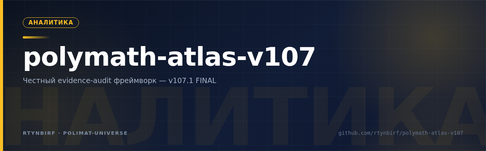
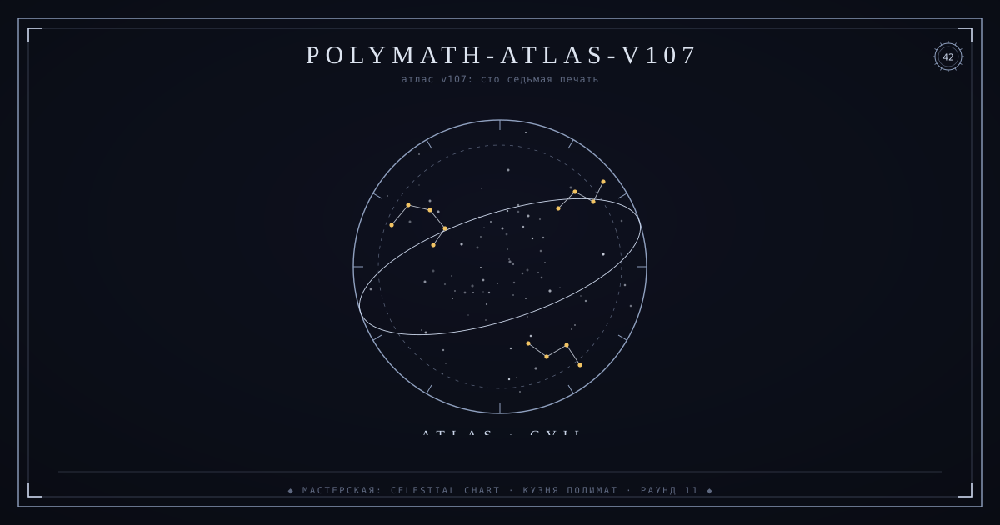
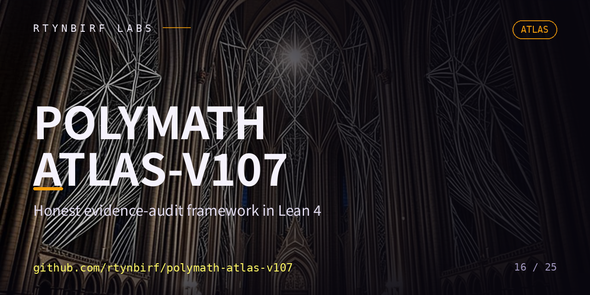

<div align="center">
  
</div>

<!--ФОРЖ:МУЗА:НАЧАЛО-->
<div align="center">
  
  <br/>
  
</div>
<!--ФОРЖ:МУЗА:КОНЕЦ-->


# POLYMATH-ATLAS v107.1-FINAL

<p align="center"></p>


**Категория: VERIFIED ENGINEERING FRAMEWORK (прототип). НЕ теорем-проверитель. НЕ математическая система.**

Канонический вердикт: `EVIDENCE-READY / CORE-VERIFIED / NOT-MATHEMATICAL`

---

## Что это

Фреймворк аудита доказательности для формальных систем:

- **`CanonicalStatus`** — 15-значная схема статусов (замена конфликтным булевым флагам)
- **`EvidenceVector`** — 8 независимых измерений доказательности вместо одномерного "Proven"
- **`TerminalGate`** — композитный гейт из 7 условий вместо бинарного "Open = 0"
- **`GapRegistry`** — 8 известных разрывов (5×P0, 1×P1, 2×P2) с честными блокерами

## Честные ограничения (читай до использования)

1. **Статус сборки: НЕ ПРОВЕРЕН НЕЗАВИСИМО.** Публичная сборка здесь — это и есть независимая верификация. Если `lake build` у тебя проходит — ты только что закрыл условие `required_compile_pass` внешним свидетелем.
2. **9 из 14 модулей — скелеты**: типы определены, доказательств нет.
3. **5 P0-P1 разрывов открыты**: феноменальное (P0-02), гроундинг (P0-03), язык (P0-04), темпоральность (P0-05), патология (P0-06).
4. **TerminalGate 6/7 PASS (85.7%)** — метрика, определённая самой системой. Самооценка, не внешний суд.
5. **Доказательства Frobenius-пары — скелетные** (`rfl` на конкретных примерах, не общие теоремы).

## Open Verification Protocol — как проверить независимо

```bash
git clone <this-repo>
cd polymath-atlas-v107

# 1. Тулчейн (elan ставит нужную версию сам по lean-toolchain)
elan --version   # https://leanprover-community.github.io/get_started.html

# 2. Кэш Mathlib (экономит ~30 минут компиляции)
lake exe cache get

# 3. Сборка всех 14 модулей
lake build 2>&1 | tee build.log

# 4. Аудит аксиом
for m in PolymathAtlas/*.lean; do
  echo "=== $m ==="
  lean --print-axioms "$m"
done 2>&1 | tee axioms.log

# 5. Хеши артефактов
sha256sum PolymathAtlas/*.lean build.log axioms.log > hashes.txt
```

Или одной командой: `chmod +x install_and_verify.sh && ./install_and_verify.sh`

**Если сборка падает — задокументируй ошибку в issue. Падение сборки тоже результат аудита.** Скрипт не подделывает SUCCESS: он сообщает реальный статус и пишет логи.

## Конфигурация

| Параметр | Значение |
|---|---|
| Toolchain | `leanprover/lean4:v4.28.0` (выровнен с Mathlib-тегом) |
| Mathlib | `v4.28.0` (~3 GB, первый `lake update` ≈ 30 мин) |
| Модулей | 14 (`PolymathAtlas/*.lean`) |
| Exe-таргет | нет (только библиотека) |

## История аудита

| Версия | Что случилось |
|---|---|
| v106.1 | Ложный SUCCESS при падающей сборке — пойман аудитом |
| v107.0 | 19 ошибок в AxiomAudit.lean, отчёт скрыл — пойман аудитом |
| v107.1-FINAL | Честная фиксация: 6 багов кода (`∨` на Bool, typos), 4 бага конфигурации (toolchain mismatch, дубль таргета, srcDirs, отсутствующий Main), 1 баг скрипта (перезапись lean-toolchain) |

## Лицензия

Данные и структура — открыты для независимой верификации. Истина не имеет копирайта.

## Якоря как формальные инварианты (Волна ×4 · П46, issue #3)

**Честный фоллбек:** Lean-тулчейн (lake + Mathlib v4.28.0, ~3 ГБ) в среде Волны ×4
недоступен, поэтому предложение «VERIFICATION_ANCHORS как теоремы Lean» исполнено
как **машиночитаемые формальные инварианты** — 🟡 про Lean компилятор остаётся открытой.

- `VERIFICATION_ANCHORS.json` — реестр якорей: каждый якорь, не доказанный
  компилятором, объявлен **`axiom`** (axioms == недоказанным якорям == 16).
  Топ-уровневых `axiom`-деклараций в коде — 0 (grep по `^axiom`, проверяется I5).
- `scripts/verify_anchors.py` — проверяющий (std-only): I1 пломбы живы,
  I2 «proven» невозможен без тулчейна, I3 счёт аксиом сходится, I4 каждый
  модуль покрыт якорем, I5 кодовые аксиомы не спрятаны. `--selftest` зелёный.

```bash
python3 scripts/verify_anchors.py            # сверка реестра с деревом (rc=0)
python3 scripts/verify_anchors.py --selftest # самоиспытание проверяющего
python3 scripts/verify_anchors.py --txt      # осмотр VERIFICATION_ANCHORS.txt
```

**Факт осмотра .txt (2026-11-09):** 18/19 пломб живы; `README.md` менялся после
генерации 2026-11-04 — пломба устарела [О], зафиксировано, не подчищено. Переход
на Lean (при появлении тулчейна): `lake build` rc=0 → статусы «proven» по фактам
сборки, аксиомный список — по `#print axioms`.

<!--ФОРЖ:ПОДВАЛ-->
---

<div align="center">
  <sub>◆ картина и штандарт — ручная ковка <a href="https://github.com/rtynbirf">КУЗНИ ПОЛИМАТ</a> · ЧЕЛОВЕК=АККАУНТ=PID1 ◆</sub>
</div>
